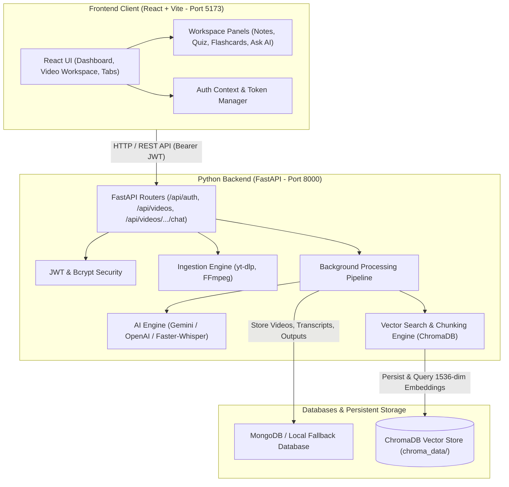

# DeepDive AI — Complete Technical Architecture & Developer Reference

This document provides a comprehensive, end-to-end technical overview of **DeepDive AI**. It is designed so that any software engineer, developer, or student can clone this repository, understand every architectural design choice, run the project locally in VS Code, and extend its capabilities.

---

## Table of Contents
1. [Project Overview](#1-project-overview)
2. [Complete Technology Stack](#2-complete-technology-stack)
3. [Complete Project Architecture](#3-complete-project-architecture)
4. [Complete Folder Structure](#4-complete-folder-structure)
5. [Frontend Implementation](#5-frontend-implementation)
6. [Backend Implementation](#6-backend-implementation)
7. [Complete Video Processing Pipeline](#7-complete-video-processing-pipeline)
8. [Database Architecture & Data Models](#8-database-architecture--data-models)
9. [Comprehensive API Reference](#9-comprehensive-api-reference)
10. [Environment Variables Reference](#10-environment-variables-reference)
11. [VS Code Setup & Installation Guide](#11-vs-code-setup--installation-guide)
12. [Running the Complete Application](#12-running-the-complete-application)
13. [Comprehensive Troubleshooting Guide](#13-comprehensive-troubleshooting-guide)
14. [Security & Production Deployment](#14-security--production-deployment)
15. [Future Roadmap & Improvements](#15-future-roadmap--improvements)

---

## 1. Project Overview

### What is DeepDive AI?
**DeepDive AI** is an intelligent video learning and comprehension platform that transforms dense educational content (lectures, tutorials, conference talks, webinars, and study videos) into structured, actionable study materials and an interactive AI learning partner.

### The Problem It Solves
Students, self-taught developers, and researchers spend countless hours manually scrubbing through long videos, pausing to take handwritten or digital notes, losing track of timestamped topics, and struggling to quickly locate specific explanations. Traditional note-taking tools are passive and disconnected from the video timeline.

### Core Capabilities
- **Effortless Ingestion**: Paste any public YouTube URL or upload a raw video/audio file (`.mp4`, `.mov`, `.mkv`, `.webm`, `.mp3`, `.wav`).
- **Precision Time-Stamped Transcripts**: Automatically generates exact chronological speech-to-text transcripts.
- **Smart Study Notes**: Topic-wise Markdown notes with bold key terms, technical definitions, formulas, and conclusions.
- **Key Video Moments**: Interactive chapter checkpoints that jump the embedded video player to exact timestamps.
- **Knowledge Retention Tools**: Auto-generated revision flashcards and multiple-choice quizzes with explanations.
- **Grounded "Ask AI" Assistant**: A conversational video tutor that retrieves vector context via **ChromaDB** and answers user questions strictly based on lecture transcripts, complete with clickable jump timestamps (e.g., `[3:25]`).

---

## 2. Complete Technology Stack

### Frontend
- **React 18 (`react`, `react-dom`)**: Declarative component-based UI rendering.
- **Vite 5 (`vite`, `@vitejs/plugin-react`)**: High-performance dev server with lightning-fast Hot Module Replacement (HMR) and optimized Rollup production builds.
- **React Router v6 (`react-router-dom`)**: Client-side routing, protected auth guards, and route parameter extraction (`/video/:id`).
- **Tailwind CSS (`tailwindcss`, `postcss`, `autoprefixer`)**: Utility-first CSS styling enabling a clean, modern aesthetic with custom fonts and subtle palette tints.
- **React Markdown (`react-markdown`)**: Renders structured AI notes, bullet lists, bolded concepts, and code blocks safely without raw HTML injection.

### Active Backend (Python FastAPI)
- **Python 3.11+**: Core backend runtime.
- **FastAPI (`fastapi>=0.115`)**: Modern, high-performance asynchronous web framework providing automatic OpenAPI / Swagger documentation and strict request validation.
- **Uvicorn (`uvicorn[standard]>=0.30`)**: Lightning-fast ASGI web server powering the FastAPI endpoints on port `8000`.
- **Pydantic v2 (`pydantic`, `pydantic-settings`)**: Strongly-typed data validation, configuration parsing from `.env`, and schema generation.
- **PyJWT (`PyJWT>=2.8`) & Passlib / bcrypt (`bcrypt>=4.1`)**: Cryptographic token generation (HS256) and one-way password hashing for stateless user authentication.
- **yt-dlp (`yt-dlp>=2024.8.6`)**: Resilient YouTube metadata extraction, audio stream downloading, and chapter identification.
- **youtube-transcript-api**: Instant extraction of official YouTube subtitles when available, bypassing audio download overhead.
- **FFmpeg & Python Subprocess**: Audio extraction, codec resampling to mono 16kHz MP3, and media duration probing.

### AI Integration
- **OpenAI API (`openai>=1.50`)**:
  - `whisper-1`: Cloud speech-to-text transcription with segment-level timestamps.
  - `gpt-4o-mini`: High-speed JSON-structured synthesis for notes, quizzes, flashcards, and Q&A.
  - `text-embedding-3-small`: 1536-dimensional semantic embeddings for ChromaDB vector search.
- **Google Gemini API (`google-generativeai`)**:
  - `models/gemini-2.5-flash`: Resilient, zero-latency model for study notes, summaries, quizzes, flashcards, and grounded Q&A.
- **Local Faster-Whisper (`faster-whisper`)**:
  - Resilient offline fallback (`tiny` CPU int8 quantization) that transcribes media locally without consuming external cloud API quotas.

### Database Layer
- **MongoDB / PyMongo (`pymongo>=4.8`)**: Primary document database for storing user accounts, video metadata, processing pipelines, transcripts, outputs, and chat histories.
- **Persistent Local Fallback Layer (`backend/data/local_db.pkl`)**: Built-in state serializer that allows the platform to function without external Docker or MongoDB server installations.
- **ChromaDB (`chromadb>=0.5`)**: Embedded vector database storing semantic transcript chunks with cosine distance metrics for Ask AI similarity queries.

---

## 3. Complete Project Architecture



---

## 4. Complete Folder Structure

```
deepdive-ai/
├── .gitignore                    # Excludes node_modules, .venv, .env, videos, and Chroma caches
├── docker-compose.yml            # Container definition for optional local MongoDB
├── README.md                     # High-level project summary and quickstart
├── EXPLAIN.md                    # Complete developer & architectural documentation (this file)
│
├── frontend/                     # React Vite Single Page Application
│   ├── package.json              # Node.js dependencies and build scripts
│   ├── vite.config.js            # Vite configuration & /api proxy to port 8000
│   ├── tailwind.config.js        # Custom typography, serif display fonts & color palette
│   ├── postcss.config.js         # PostCSS plugins for Tailwind CSS
│   ├── index.html                # Single HTML entry template
│   ├── .env.example              # Frontend environment template
│   └── src/
│       ├── main.jsx              # React DOM root bootstrapping
│       ├── App.jsx               # Top-level route switch & protected route guards
│       ├── auth.jsx              # Authentication context provider & token listener
│       ├── api.js                # Centralized Fetch API client & time formatting helpers
│       ├── index.css             # Tailwind base styles and custom button/card classes
│       ├── components/
│       │   ├── Layout.jsx        # Navigation header with user greeting & logout
│       │   ├── panels.jsx        # Interactive panels (Notes, Quiz, Flashcards, Chat, Search)
│       │   └── StatusPill.jsx    # Real-time processing status indicators
│       └── pages/
│           ├── AuthPage.jsx      # Sign in / Account registration screen
│           ├── Dashboard.jsx     # Video submission input, library grid, & progress cards
│           └── VideoPage.jsx     # Full video workspace with embedded player & tabbed tools
│
└── backend/                      # FastAPI Python Application
    ├── requirements.txt          # Python packages (FastAPI, Uvicorn, PyMongo, ChromaDB, etc.)
    ├── .env.example              # Backend environment configuration template
    ├── bin/                      # Platform binaries (ffmpeg.exe)
    ├── data/                     # Persistent local database store (local_db.pkl)
    ├── chroma_data/              # ChromaDB persistent vector database directory
    └── app/
        ├── __init__.py
        ├── main.py               # FastAPI application lifecycle, CORS, health endpoint
        ├── config.py             # Pydantic BaseSettings loading from .env
        ├── db.py                 # MongoDB client & persistent local fallback engine
        ├── security.py           # Bcrypt password hashing & JWT token verification
        ├── schemas.py            # Pydantic request and response schemas
        ├── utils.py              # ObjectId serializer, UTC timestamps, ownership validation
        ├── routers/
        │   ├── auth.py           # /api/auth endpoints (register, login, me)
        │   ├── videos.py         # /api/videos endpoints (youtube, upload, list, delete, search)
        │   └── chat.py           # /api/videos/{id}/chat endpoints (ask questions, history, clear)
        └── services/
            ├── ingest.py         # YouTube probing, video validation, FFmpeg audio extraction
            ├── ai.py             # Whisper transcription, Gemini/GPT generation, prompt templates
            ├── rag.py            # Transcript chunking, vector embeddings, ChromaDB search
            └── pipeline.py       # Asynchronous background job orchestrating end-to-end processing
```

---

## 5. Frontend Implementation

### Routing & Authentication Flow
- **Protected Routing (`frontend/src/App.jsx`)**: The `<Protected />` wrapper verifies `user` state inside `useAuth()`. If no token exists in `localStorage`, the user is immediately redirected to `/auth`.
- **Auth Context (`frontend/src/auth.jsx`)**: Persists the JWT in `localStorage` under key `dd_token`. On mount, it calls `api.me()` to populate the user profile (`name`, `email`, `id`). It listens for global `dd-logout` events to cleanly reset application state on 401 responses.
- **Vite Reverse Proxy (`frontend/vite.config.js`)**:
  ```javascript
  server: {
    proxy: {
      '/api': {
        target: 'http://localhost:8000',
        changeOrigin: true,
      }
    }
  }
  ```
  This eliminates Cross-Origin Resource Sharing (CORS) complications during local development.

### Interactive Workspace (`VideoPage.jsx` & `panels.jsx`)
- **Video Workspace**: Displays the YouTube embed (or file upload indicator) on the left, and a tabbed control panel on the right.
- **Real-Time Polling**: When a video status is `queued`, `transcribing`, `generating`, or `indexing`, the page automatically polls `/api/videos/:id` every 3 seconds to update the `StatusPill` and step progress dots.
- **Smart Timestamp Jumping (`Linkified` Component)**:
  - Text citations from AI responses (e.g. `[2:15]` or `[0:44, 7:24]`) are dynamically parsed.
  - Clicking any timestamp passes seconds into `onSeek(seconds)`, instantly seeking the video player to that exact second.

---

## 6. Backend Implementation

### Server Lifecycle (`backend/app/main.py`)
- Initializes indexes on startup via the `lifespan` context manager.
- Configures CORS middleware for `http://localhost:5173`.
- Mounts modular routers: `auth`, `videos`, and `chat`.
- Exposes `/api/health` providing live status of MongoDB, OpenAI keys, Gemini, and FFmpeg binary availability.

### Media Ingestion (`backend/app/services/ingest.py`)
- Automatically probes Windows system PATH, user directories, and `backend/bin/ffmpeg.exe`.
- Validates uploaded media file extensions against audio/video formats.
- Extracts duration directly from media metadata without requiring external `ffprobe` tools.

### Background Job Orchestration (`backend/app/services/pipeline.py`)
- Executes asynchronously via FastAPI `BackgroundTasks`.
- Isolates temporary files in dedicated per-job temporary folders (`dd_*`) and guarantees full cleanup in `finally` blocks upon completion.

---

## 7. Complete Video Processing Pipeline

```
1. Video Input (YouTube URL or Local Video File)
      │
2. Metadata Probe & Validation (yt-dlp / FFmpeg duration check)
      │
3. Transcript Extraction (First checks YouTube native subtitles; falls back to audio extraction)
      │
4. Audio Slicing & Preprocessing (FFmpeg converts stream to mono 16kHz MP3 chunks)
      │
5. Speech-to-Text Transcription (OpenAI Whisper-1 or local faster-whisper on CPU)
      │
6. Synthesis & Material Generation (Google Gemini 2.5 Flash / GPT-4o-mini)
      ├── Structured Study Notes (Markdown)
      ├── Summary (4-6 sentence overview)
      ├── Chronological Key Moments & Chapters
      ├── Action Items & Tasks
      ├── Revision Flashcards (Questions & Answers)
      └── Practice Quiz (MCQs with Explanations)
      │
7. Semantic Chunking & Vector Indexing (ChromaDB + 1536-dim embeddings)
      │
8. Database Storage & Status Update -> "ready"
      │
9. Ask AI Grounded Q&A Enabled
```

---

## 8. Database Architecture & Data Models

### Collections in MongoDB
1. **`users`**
   - `_id`: Unique user ObjectId
   - `name`: String
   - `email`: Lowercase String (Indexed, Unique)
   - `password_hash`: Bcrypt hashed string
   - `created_at`: UTC ISO Datetime
2. **`videos`**
   - `_id`: Unique video ObjectId
   - `user_id`: String (Foreign reference to `users._id`)
   - `source`: `"youtube"` | `"upload"`
   - `youtube_id`: String (optional)
   - `url`: String
   - `title`: String
   - `duration`: Float (seconds)
   - `thumbnail`: String URL
   - `channel`: String
   - `status`: `"queued"` | `"transcribing"` | `"generating"` | `"indexing"` | `"ready"` | `"failed"`
   - `stage_message`: User-friendly status message
   - `error`: Error details if failed
   - `created_at` / `updated_at`: UTC Datetime
3. **`transcripts`**
   - `video_id`: String (Indexed, Unique)
   - `segments`: Array of `{"start": float, "end": float, "text": string}`
   - `text`: Full concatenated transcript string
4. **`outputs`**
   - `video_id`: String (Indexed, Unique)
   - `user_id`: String
   - `summary`: String
   - `notes_markdown`: Formatted Markdown String
   - `key_timestamps`: Array of `{"time_seconds": int, "title": str, "description": str}`
   - `action_items`: Array of `{"task": str, "time_seconds": int | null}`
   - `flashcards`: Array of `{"question": str, "answer": str}`
   - `quiz`: Array of `{"question": str, "options": [str], "answer_index": int, "explanation": str}`
5. **`chat_history`**
   - `video_id`: String
   - `user_id`: String
   - `role`: `"user"` | `"assistant"`
   - `content`: String
   - `sources`: Array of chunk citations with start/end timestamps and similarity scores
   - `created_at`: UTC Datetime

---

## 9. Comprehensive API Reference

### Authentication APIs
- **`POST /api/auth/register`**
  - **Body**: `{"name": "string", "email": "string", "password": "string"}`
  - **Response (201)**: `{"token": "jwt_token_string", "user": {"id": "...", "name": "...", "email": "..."}}`
- **`POST /api/auth/login`**
  - **Body**: `{"email": "string", "password": "string"}`
  - **Response (200)**: `{"token": "jwt_token_string", "user": {"id": "...", "name": "...", "email": "..."}}`
- **`GET /api/auth/me`**
  - **Headers**: `Authorization: Bearer <token>`
  - **Response (200)**: `{"id": "...", "name": "...", "email": "..."}`

### Video Management APIs
- **`POST /api/videos/youtube`**
  - **Headers**: `Authorization: Bearer <token>`
  - **Body**: `{"url": "https://www.youtube.com/watch?v=..."}`
  - **Response (202)**: Returns video document with status `"queued"`.
- **`POST /api/videos/upload`**
  - **Headers**: `Authorization: Bearer <token>`
  - **Body**: `multipart/form-data` with `file: Binary`
  - **Response (202)**: Returns video document with status `"queued"`.
- **`GET /api/videos`**
  - **Headers**: `Authorization: Bearer <token>`
  - **Response (200)**: List of user videos sorted newest first.
- **`GET /api/videos/{video_id}`**
  - **Headers**: `Authorization: Bearer <token>`
  - **Response (200)**: `{"video": {...}, "outputs": {...}}`
- **`DELETE /api/videos/{video_id}`**
  - **Headers**: `Authorization: Bearer <token>`
  - **Response (204)**: Deletes video, transcript, outputs, chat history, and ChromaDB vector index.

### Ask AI & Search APIs
- **`POST /api/videos/{video_id}/chat`**
  - **Headers**: `Authorization: Bearer <token>`
  - **Body**: `{"question": "What tools are mentioned in this video?"}`
  - **Response (200)**: `{"answer": "...", "sources": [{"text": "...", "start": 10.0, "end": 25.0, "score": 0.85}]}`
- **`GET /api/videos/{video_id}/chat`**
  - **Headers**: `Authorization: Bearer <token>`
  - **Response (200)**: Chronological list of user and assistant messages for this video.
- **`DELETE /api/videos/{video_id}/chat`**
  - **Headers**: `Authorization: Bearer <token>`
  - **Response (204)**: Clears conversation history for this video.

### Health Check API
- **`GET /api/health`**
  - **Response (200)**:
    ```json
    {
      "status": "ok",
      "database": true,
      "videos_count": 2,
      "users_count": 1,
      "openai_key_set": true,
      "ffmpeg": {
        "available": true,
        "path": "C:\\path\\to\\ffmpeg.exe"
      },
      "ffprobe": {
        "available": false,
        "path": null
      }
    }
    ```

---

## 10. Environment Variables Reference

Create a file named `.env` inside the `backend/` directory based on `.env.example`:

| Variable | Description | Required | Default |
| :--- | :--- | :--- | :--- |
| `OPENAI_API_KEY` | OpenAI API key with credit balance | Optional (if using Gemini) | `""` |
| `OPENAI_CHAT_MODEL` | OpenAI Chat model | Optional | `gpt-4o-mini` |
| `OPENAI_TRANSCRIBE_MODEL` | OpenAI speech-to-text model | Optional | `whisper-1` |
| `OPENAI_EMBED_MODEL` | OpenAI vector embedding model | Optional | `text-embedding-3-small` |
| `GEMINI_API_KEY` | Google Gemini API key | Recommended | `""` |
| `GEMINI_MODEL` | Google Gemini model identifier | Optional | `models/gemini-2.5-flash` |
| `MONGODB_URI` | MongoDB connection URI | Optional (falls back to local store) | `mongodb://localhost:27017` |
| `MONGODB_DB` | MongoDB database name | Optional | `deepdive_ai` |
| `JWT_SECRET` | 256-bit cryptographic secret for tokens | **Yes** | 32+ character secret |
| `JWT_EXPIRE_MINUTES` | Token session lifetime in minutes | Optional | `10080` (7 days) |
| `CHROMA_PATH` | Path where ChromaDB persists data | Optional | `./chroma_data` |
| `CORS_ORIGINS` | Allowed frontend origins | Optional | `http://localhost:5173` |
| `MAX_UPLOAD_MB` | Maximum video file upload size in MB | Optional | `500` |
| `MAX_VIDEO_MINUTES` | Maximum video duration in minutes | Optional | `180` |
| `FFMPEG_PATH` | Explicit path to `ffmpeg.exe` | Optional | Auto-detected |

---

## 11. VS Code Setup & Installation Guide

Follow these step-by-step instructions after cloning the repository:

### Step 1: Open Project in VS Code
Launch VS Code and open the root folder:
```bash
code C:\Users\tambo\Downloads\deepdive-ai-1\deepdive-ai
```

### Step 2: Install System Dependencies
1. **Node.js**: Download and install Node.js v18 or v20 LTS from [nodejs.org](https://nodejs.org/).
2. **Python**: Download and install Python 3.11 from [python.org](https://www.python.org/). *Ensure you check "Add Python to PATH" during installation.*
3. **FFmpeg (Windows)**:
   - Download the essentials build from [gyan.dev/ffmpeg/builds](https://www.gyan.dev/ffmpeg/builds/).
   - Extract and place `ffmpeg.exe` into `backend/bin/ffmpeg.exe`, or add its `bin` folder to your Windows user PATH.

---

## 12. Running the Complete Application

Open two separate terminals in VS Code:

### Terminal 1: Backend Server (FastAPI)
```powershell
cd backend
python -m venv .venv
.\.venv\Scripts\activate
pip install -r requirements.txt
python -m uvicorn app.main:app --host 0.0.0.0 --port 8000 --reload
```
*Expected log output:*
```
INFO: Uvicorn running on http://0.0.0.0:8000 (Press CTRL+C to quit)
```

### Terminal 2: Frontend Client (React + Vite)
```powershell
cd frontend
npm install
npm run dev
```
*Expected log output:*
```
  VITE v5.4.21  ready in 350 ms

  ➜  Local:   http://localhost:5173/
  ➜  Network: use --host to expose
```

Open **`http://localhost:5173`** in your browser.

---

## 13. Comprehensive Troubleshooting Guide

| Issue | Cause | Solution |
| :--- | :--- | :--- |
| **"ffmpeg is not installed"** | FFmpeg is missing from PATH | Copy `ffmpeg.exe` directly into `backend/bin/ffmpeg.exe`. |
| **"OpenAI Quota Exceeded (429)"** | OpenAI API key has zero balance | Add a Google Gemini API key to `GEMINI_API_KEY` in `backend/.env`. |
| **"Could not connect to MongoDB"** | Local MongoDB service is offline | The app automatically uses the persistent local store (`backend/data/local_db.pkl`). No action required! |
| **Blank Screen on Ask AI tab** | Non-standard timestamp format | Updated in `panels.jsx` to parse single and grouped timestamps safely. |
| **CORS errors in console** | Calling backend on port 8000 directly | Ensure Vite development server is running on port 5173 with proxy configured. |

---

## 14. Security & Production Deployment

- **Secret Isolation**: Never commit active `.env` files. Ensure `.gitignore` ignores all `.env` files and local data caches.
- **Stateless Tokens**: Authentication uses industry-standard JWT with expiration times, allowing horizontal scaling across container replicas.
- **Production Containerization**: Deploy using the provided `docker-compose.yml` or containerize frontend static assets behind Nginx.

---

## 15. Future Roadmap & Improvements

- [ ] Export study notes directly to PDF and Notion.
- [ ] Multi-lingual speech synthesis to listen to notes as audio summaries.
- [ ] Collaborative study rooms with shared video notes.
